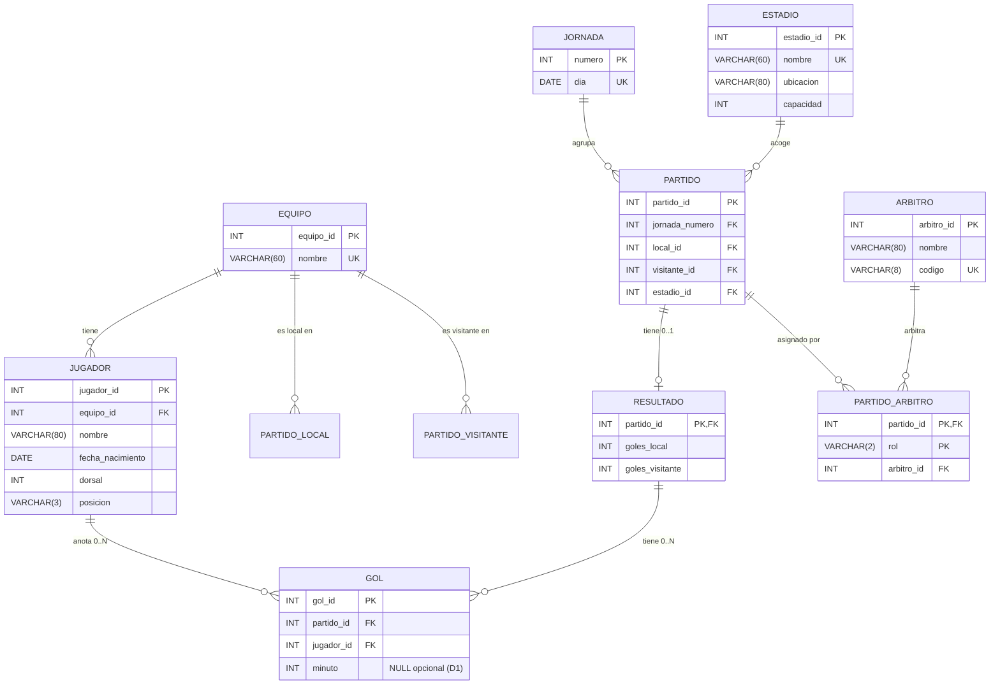

# 02 · Modelo Entidad-Relación (E-R)

> **Liga Universitaria del Valle · Campeonato de Fútbol 2026**
> Documento de la Fase 2 del proyecto. Define las entidades, atributos,
> identificadores, relaciones con sus roles, cardinalidades y participación,
> y argumenta por qué `Partido—Resultado` es **1:0..1**, `Partido—Árbitro`
> es **N:M** y `Gol` se modela como **entidad**.
>
> El diagrama fuente está en Mermaid (más abajo). Se puede renderizar a PNG/PDF
> con cualquier visor Mermaid (mermaid.live, extensión de VSCode, etc.). El
> archivo renderizable se entrega como `02_modelo_er.png` aparte.

---

## 2.1 Entidades, atributos e identificadores

Las 9 entidades del modelo y sus identificadores primarios:

| Entidad | Identificador | Atributos (resumen) |
|---|---|---|
| `Equipo` | `equipo_id` | `nombre` |
| `Jornada` | `numero` | `dia` |
| `Estadio` | `estadio_id` | `nombre`, `ubicacion`, `capacidad` |
| `Arbitro` | `arbitro_id` | `nombre`, `codigo` |
| `Jugador` | `jugador_id` | `equipo_id`, `nombre`, `fecha_nacimiento`, `dorsal`, `posicion` |
| `Partido` | `partido_id` | `jornada_numero`, `local_id`, `visitante_id`, `estadio_id` |
| `Resultado` | `partido_id` (PK = FK) | `goles_local`, `goles_visitante` |
| `Partido_Arbitro` | `(partido_id, rol)` | `arbitro_id`, `rol` |
| `Gol` | `gol_id` | `partido_id`, `jugador_id`, `minuto` |

## 2.2 Diagrama E-R (Mermaid)

> **Nota sobre los roles de `Equipo`:** para que Mermaid pueda representar los
> dos roles `local` y `visitante` sobre una sola entidad `Equipo`, el diagrama
> usa dos relaciones etiquetadas (`PARTIDO_LOCAL`, `PARTIDO_VISITANTE`) que
> confluyen en la misma entidad `PARTIDO`. En el modelo E-R final, ambas
> asociaciones apuntan a la **misma** entidad `Equipo`; solo cambia la etiqueta
> del rol. Esto satisface la constitución C2: no se duplica la entidad.

## 2.3 Lectura de cardinalidades (en prosa)

| Relación | Lectura directa | Lectura inversa |
|---|---|---|
| `Equipo 1 — N Jugador` | Un equipo tiene 0..N jugadores. | Un jugador pertenece a **un** equipo. |
| `Equipo 1 — N Partido` (rol local) | Un equipo juega como local en 0..N partidos. | Un partido tiene **un** local. |
| `Equipo 1 — N Partido` (rol visitante) | Un equipo juega como visitante en 0..N partidos. | Un partido tiene **un** visitante. |
| `Jornada 1 — N Partido` | Una jornada agrupa 0..N partidos. | Un partido pertenece a **una** jornada. |
| `Estadio 1 — N Partido` | Un estadio acoge 0..N partidos. | Un partido se juega en **un** estadio. |
| `Partido 1 — 0..1 Resultado` | Un partido tiene **cero o un** resultado. | Un resultado pertenece a **un** partido (identificación). |
| `Resultado 1 — 0..N Gol` | Un resultado tiene **cero o muchos** goles. | Un gol corresponde a **un** resultado. |
| `Jugador 1 — 0..N Gol` | Un jugador anota **cero o muchos** goles. | Un gol es anotado por **un** jugador. |
| `Partido N — M Arbitro` | Un partido es arbitrado por **N** árbitros (3 concretos). | Un árbitro arbitra **M** partidos. |

## 2.4 Justificaciones explícitas

### ¿Por qué `Partido — Resultado` es **1:0..1**?

- Cada partido se juega una sola vez en el campeonato (no hay ida y vuelta
  con repetición de la misma fila de partido: la vuelta es un partido distinto).
- El corte ficticio (RN-06) deja 84 partidos sin resultado: por eso la
  participación del lado `Partido` es **0..1** desde el resultado y **obligatoria
  a 1** desde el partido.
- La identificación se hace por `partido_id`: en el modelo relacional la PK de
  `resultado` coincide con la FK hacia `partido`, lo que también implementa la
  regla "un partido tiene cero o un resultado".

### ¿Por qué `Partido — Árbitro` es **N:M**?

- Cada partido tiene **3** árbitros distintos.
- Cada árbitro participa en **22** partidos distintos (uno por jornada).
- Sin atributos propios en la relación, no se justificaría la creación de la
  entidad asociativa. Pero como **el rol (`P`, `A1`, `A2`) depende de la
  asignación** (un mismo árbitro podría tener rol distinto en otro partido),
  el rol es **atributo de la relación** y obliga a modelar `Partido_Arbitro`
  como entidad asociativa con PK compuesta `(partido_id, rol)`.
- 132 partidos × 3 árbitros = 396 filas esperadas en la asociativa.

### ¿Por qué `Gol` es entidad y no atributo?

- Cada gol es un **hecho independiente**: tiene su propio identificador (`gol_id`)
  y un atributo adicional (`minuto`).
- Un partido puede tener varios goles (RN-18, RN-21), por lo que no puede
  ser atributo multivaluado de `Resultado` (rompería 1FN).
- El equipo del gol se obtiene por la participación de `Jugador`; el partido
  por la pertenencia a `Resultado`. Modelar `Gol` como entidad permite conectar
  ambos lados sin duplicar el equipo en `gol`.

## 2.5 Cierre de la Fase 2

- ✅ El diagrama muestra las 9 entidades, atributos, identificadores y
  relaciones con roles, cardinalidades y participación.
- ✅ `Equipo` aparece **una sola vez**; los roles `local` y `visitante` se
  modelan como dos asociaciones etiquetadas a la misma entidad.
- ✅ `Partido — Resultado` es 1:0..1; `Partido — Árbitro` es N:M con atributo
  `rol`.
- ✅ `Gol` aparece como **entidad** con sus dos relaciones (a `Resultado` y a
  `Jugador`) y el atributo `minuto` (D1).
- ✅ Los nombres coinciden con el contrato de datos (§1.6 del SDD): una sola
  fuente de nombres (constitución C2).